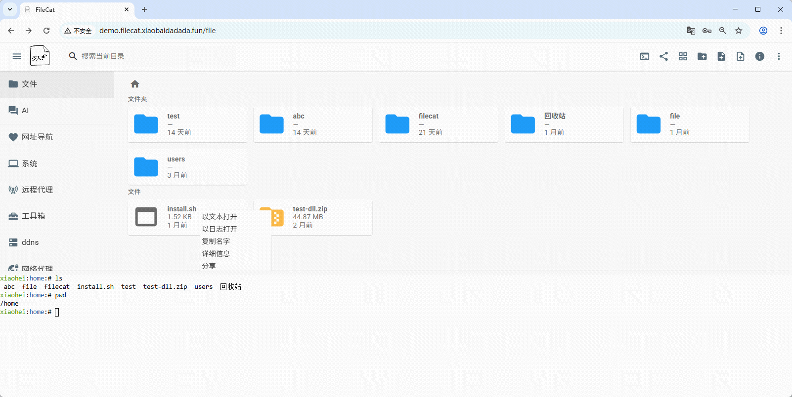
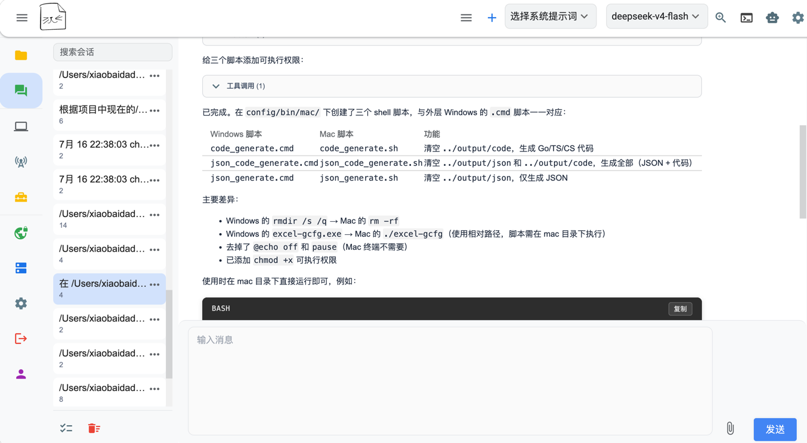
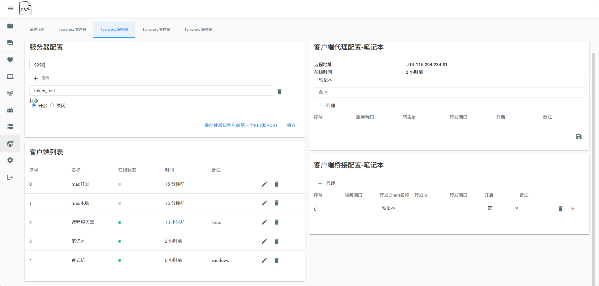
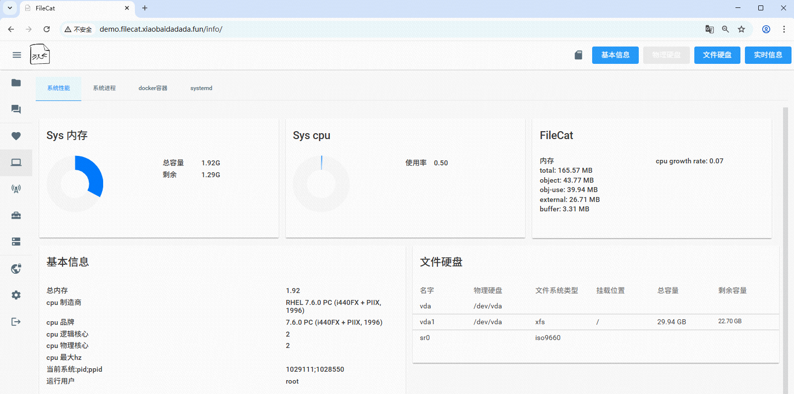

<p align="center">
  
</p>

<h1 align="center">FileCat</h1>

<p align="center">
  <i>一款自部署的 Web 文件服务器与轻量级服务器管理工具</i>
</p>

<p align="center">
  <a href="https://www.npmjs.com/package/filecat">
    
  </a>
  <a href="https://www.npmjs.com/package/filecat">
    
  </a>
  <a href="https://github.com/xiaobaidadada/filecat">
    
  </a>
  <a href="https://ghcr.io/xiaobaidadada/filecat">
    
  </a>
  <a href="https://github.com/xiaobaidadada/filecat/blob/main/LICENSE">
    
  </a>
</p>

<p align="center">
  <a href="#功能特性">功能特性</a> •
  <a href="#功能截图">功能截图</a> •
  <a href="#安装方式">安装方式</a> •
  <a href="#快速运行">快速运行</a>
</p>

<p align="center">
  <a href="./doc/EN_README.md">English</a>
</p>

---

FileCat 是一个需要自己部署的 Web 文件服务器，同时也是一款**轻量级服务器管理工具**。部署后，你可以随时随地通过浏览器管理服务器上的文件，并享受丰富的运维功能。

FileCat是采用[filebrowser](https://github.com/filebrowser/filebrowser)的ui来实现的。

> **核心理念**：以文件管理为核心，融合 AI Agent、远程桌面、内网穿透、系统监控等能力，让服务器管理变得更简单。

---

## 功能特性

| 类别 | 功能 |
|------|------|
| 文件管理 | 浏览、上传、下载、重命名、移动、复制、压缩解压，支持拖拽上传与分页滚动加载 |
| 文件预览 | 图片、视频、音频、PDF、Office 文档、epub小说、Markdown、代码、日志等格式在线预览 |
| Office 编辑器 | 在线编辑 Word（docx）、Excel（xlsx）、PowerPoint（pptx），无需本地安装 Office |
| Markdown 所见即所得 | 类 Typora 的实时预览编辑，内置 7 套主题，支持 Mermaid / SVG 绘图与 KaTeX 公式 |
| 代码编辑器 | 内置 Ace 编辑器，支持语法高亮、多语言识别与 Studio 分栏代码模式 |
| 超大日志查看 | 任意大小的日志文件秒开，支持虚拟滚动、实时追踪与关键字高亮 |
| 深度搜索 | 递归搜索文件名或文件内容，支持正则、忽略大小写与排除过滤，点击搜索框左侧放大镜打开 |
| 网盘与协议挂载 | 将 百度网盘 / SSH(SFTP) / S3 / WebDAV / SMB 挂载为本地目录，与本地文件使用同一套操作 |
| 文件服务 | 反向把本地目录通过 SMB / WebDAV / SFTP 对外提供，可被 Windows 资源管理器等标准客户端直接访问 |
| 内网穿透 | 将内网服务暴露到公网，或多个内网之间互相通信；多机部署后可实现跨机器的文件同步与 CI/CD 自动化 |
| SSH 终端 | 浏览器内置 Web 终端，随时连接服务器，支持挂载的 SSH 主机直连 |
| Windows 远程桌面 | 浏览器中直接操作远程 Windows 桌面（RDP） |
| CI/CD 工作流 | 支持自定义命令流水线（.workflow.yml / .act），实现持续集成与部署 |
| 系统管理 | 系统信息看板（CPU / 内存 / 磁盘 / 网络）、进程管理、systemd 服务、防火墙（ufw / nftables）、Docker 配置 |
| Git 管理 | 内置 Git 客户端，支持变更暂存提交、提交历史树形图、分支与远程分支管理、Diff 对比、Blame、Stash、Tag |
| AI Agent | 集成大语言模型智能辅助运维与文件处理（需自行配置 API），支持接入 QQ / 企业微信 / 飞书 / 钉钉 机器人 |
| Excalidraw 绘图 | 内置白板绘图工具，可直接编辑 .draw 文件 |
| 多用户管理 | 完善的权限体系，支持角色、用户级权限配置与目录访问限制 |
| 可分享链接 | 生成文件或目录的分享链接，可设置密码与有效期 |

---

## 功能截图

<table>
  <tr>
    <td align="center"><b>文件列表</b></td>
    <td align="center"><b>AI Agent</b></td>
  </tr>
  <tr>
    <td></td>
    <td></td>
  </tr>
  <tr>
    <td align="center"><b>内网穿透</b></td>
    <td align="center"><b>系统信息看板</b></td>
  </tr>
  <tr>
    <td></td>
    <td></td>
  </tr>
</table>

---

## Demo

在线体验地址：**[http://demo.filecat.xiaobaidadada.fun/](http://demo.filecat.xiaobaidadada.fun/)**

账号密码： `demo`/`demo`或者 `test`/`test`

> Demo 服务器由 [野草云](https://my.yecaoyun.com/aff.php?aff=7185) 赞助提供

---

## 安装方式

> 小版本 bug 修复与功能更新仅在 npm 上实时发布同步。

### 1. NPM 安装（推荐）

```bash
npm install -g filecat
```

对于 linux 系统，安装后可以选择使用 `pm2` 保活，或注册到 systemd保活。

### 2. Linux 一键脚本

```bash
curl -o install.sh https://filecat.xiaobaidadada.fun/files/linux-install.sh && bash install.sh
```

自动下载二进制包并执行安装，按提示输入参数即可。

### 3. 二进制包

从 [Releases](https://github.com/xiaobaidadada/filecat/releases) 下载对应系统的最新版本。

### 4. Docker

```bash
docker run -d --name filecat --restart=always --net=host \
  -v /home:/home \
  ghcr.io/xiaobaidadada/filecat:latest \
  --port 5567 --base_folder /home
```

### 5. 源码编译

```bash
git clone https://github.com/xiaobaidadada/filecat.git
cd filecat
npm install
npm run dev        # 开发模式
# 或
npm run build && node build/main.js  # 生产模式
```

---

## 快速运行

**方式一**：NPM 安装后执行：
```bash
filecat --port 5567
```

**方式二**：二进制包解压后，目录内有 `filecat-run.sh`（Linux/Mac）或 `filecat-run.cmd`（Windows）运行脚本。

**默认账号/密码**：`admin` / `admin`

> 更多参数请使用 `filecat --help` 查看。

> **权限提示**：安装后默认能访问的文件目录是安装目录，请在设置中为每个用户配置可访问目录及执行权限。

---


## 社区交流

加入 QQ 群 **824838674** 进行交流反馈


